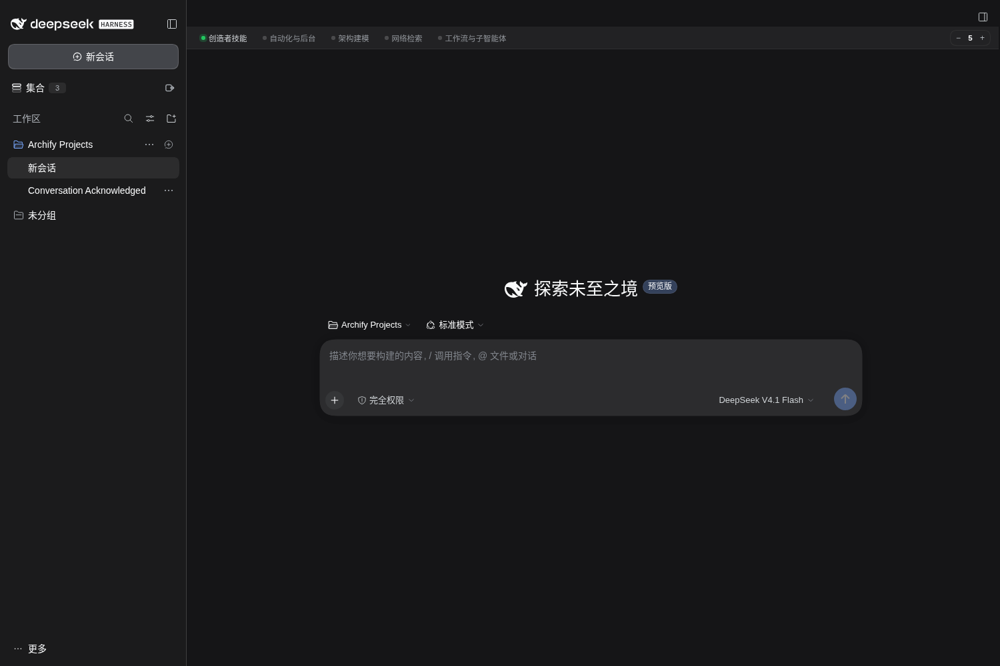
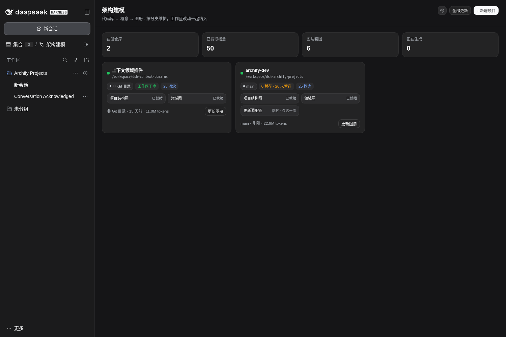

# dsh-leftpanel · 左栏菜单管理

> DeepSeek Harness 插件：把左侧菜单的面板入口收进一行「集合」，并逐个隐藏或显示。
> 入口在 **设置 → 左栏菜单**。

## 集合模式（默认开启）

左侧菜单里原本一行一个的面板入口（插件、自动化任务、架构建模……）会被收成**一行**：

```
[集合图标] 集合  (7)  /  [所选图标] Horon 记忆          [◫→]
```

- **首次点击不打开页面**：还没选过任何入口时，左栏**只有这一行**，点「集合」只会把右侧卡片打开/保持，不跳转。
- **悬浮出卡片**：从行右侧（侧栏 280 + 8）滑出一张 **448px 宽的双列卡片**，条目**逐行**填进两列（左、右、左、右……），中缝一条发丝线，已选项带 2px 强调条 + 淡底。
- **点击即选中并打开**：卡片里点某项 = 选中它并打开该页面，与直接点原来那一行完全一致；行文字立刻变成 `集合 / 图标 名称`。
- **再点直接进**：选中后点「集合」= 直接打开斜杠后那一页；悬浮仍然出卡片，可以随时换。
- **「更多」也在里面，和其它条目完全一样**：外壳溢出菜单的条目（浏览更多插件、创建你的插件……）就是**列表最后的两项**，同样逐行填进那两列，**没有分隔线、没有单独分组、没有第二层弹窗**，点击直接执行。它们不是抄来的：插件会把真实菜单开一次、读下它的行、再关掉（读取期间菜单是透明的，不会闪），所以别的插件往那个菜单里加东西也会自动跟上来。
- **键盘**：`↑↓` 沿视觉顺序走（逐行，左右左右）、`←→` 在同一行里左右挪、`Enter` 打开、`Esc` 关闭并把焦点还给行。
- **折叠侧栏**：收成 36×36 的图标轨时只留集合图标；有选中项时右下角点一个小圆点，表示「斜杠后还有东西」。
- **右端图标**：一个「面板 + 向右箭头」的标记（不是倒三角/雪佛龙），因为卡片是往右侧开，不是往下展开。

设置页里有一个 **集合模式** 开关（默认开），就在「左栏菜单」页「面板入口」表的**第一行**——页面其它部分完全不变。关掉它，面板入口和「更多」立刻恢复成原来的一行一个，卡片移除，**你自己隐藏的条目集合原样保留**。

真机效果（dsh-dev 容器，1500×1000 直出，与其它插件的 README 图同一套尺寸）：

| 刷新后未选择：左栏只有「集合」 | 悬浮展开 |
| --- | --- |
|  |  |

| 选中之后：行变 `集合 / 图标 名称` | 折叠成图标轨 |
| --- | --- |
|  |  |

设置页（原页面不变，只多一行开关）：


设计稿（含明暗两套与三帧状态）在 `mock/`，出题依据与实测令牌在 `docs/proto/collection-brief.md`。
注意 `mock/` 是**当时的候选稿**：定稿把「更多」的条目并进了同一张卡片、没有分隔线也不分组，
这几处与稿子不同，以本 README 和真机截图为准。

```bash
node scripts/shot.mjs mock/collection-B2.html out.png 1500 1000
```

## 安装

```bash
# npm（推荐）
dsh plugin --profile web add @xirizhi/dsh-leftpanel

# 或直接用 GitHub Release 上的 tarball
dsh plugin --profile web add https://github.com/guicaiyue/dsh-leftpanel/releases/latest/download/dsh-leftpanel.tgz
```

包声明了 `dsh.bundle.patch`，`dsh plugin add` 会自动把它写进 profile 的 `dsh.profile.bundles`。
手工装的话，把包名加进 profile 的 `package.json`：

```json
{
  "dsh": {
    "profile": {
      "bundles": ["@xirizhi/dsh-leftpanel"]
    }
  }
}
```

重启 DSH 后，打开 **设置**，左栏标签列里会出现「左栏菜单」。

## 它怎么工作

两个半边：

| 半边 | 文件 | 职责 |
| --- | --- | --- |
| Host | `index.js` | 把「哪些入口被隐藏」+「集合模式是否开启、选中哪一项」持久化到 Harness home 下的 `left-panel.json`，并提供 `GET/POST /api/left-panel/state` |
| Browser | `client/client.js` | 向设置页的 `settings.section` 列表注册「左栏菜单」分区，把隐藏状态应用到侧边栏行上，并注入「集合」行与它的浮层卡片 |

**为什么需要 Host 半边。** 隐藏集合必须在首屏绘制前就能读到，而且要跨重启保留。
放在 Host 侧意味着每个 profile 只有一份权威状态，浏览器侧读到的就是它。

**左栏行是怎么被隐藏的。** 侧边栏外壳拥有自己的行列表：它为 `sidebar.panellist`
的每个存活条目渲染一行，本身没有「隐藏」概念，而注销别的插件的注册也不是本插件
该做的事。本插件做的是一次表现层的处理：找到外壳那个行列表（`<nav>` 下直接挂着
面板按钮），按与外壳完全相同的排序规则把行与条目投影对齐，再用行的可访问名称
交叉校验，给命中的行打上 `data-dsh-leftpanel-hidden`，由本插件样式表里的一条规则
把它变成 `display:none`。

这样做的好处是：别的插件组件保持挂载、状态不丢；而且能自愈——`MutationObserver`
会在外壳重新渲染（切换语言、折叠/展开、插件迟到加载）时重新应用标记。当行数与
投影不一致或名称对不上时，只处理名称精确匹配的行，退化成「不隐藏任何行」，而
不会隐藏错行。

**集合行是怎么注入的。** 插件往同一个 `<nav>` 里插一个自己的按钮（`data-dsh-leftpanel-collection`），
并把它从面板投影里排除，所以它不会被自己当成一个面板项。卡片挂在 `<body>` 上、`position:fixed`，
跟着行的位置走。挂载失败时退化为「什么都不隐藏」，不会出现「菜单藏了但没有入口回来」。

**持久化。** `localStorage` 只作首屏镜像，让第一次绘制就隐藏正确的行；Host 侧的
`left-panel.json` 才是权威。每次开关都会乐观写入并回报失败。

## 存储

`<DSH home>/left-panel.json`（默认 `~/.dsh/left-panel.json`）：

```json
{
  "version": 1,
  "hidden": ["plugins", "token-dashboard"],
  "collection": { "enabled": true, "selectedId": "horon" }
}
```

- `hidden` 是用户自己隐藏的条目；集合模式开启时，面板行会全部折叠，但这个集合**不会被改写**，关掉集合模式后原样生效。
- `collection.enabled` 缺省视为 `true`（旧文件没有这个键 = 全新安装 = 开启）。
- `collection.selectedId` 是斜杠后显示的那一项；指向已消失的条目时退化为「未选」。

POST 是**局部更新**：只发 `{hidden}` 不会动 `collection`，反之亦然。

损坏的文件不会让页面报错：它降级为「什么都没隐藏」，并在日志里告警一次。

## 开发

```bash
npm run verify     # 语法检查（scripts/syntax-check.mjs）+ node --test
```

两组自检，共 38 项：

- `test/client-selfcheck.mjs`（19 项）—— 模块加载器契约、只注册设置分区（且**不**
  注册左侧行）、`t` 由 `locale` 座位提供而非 `inject` 注入、双语文案键一致、样式表
  不含远程资源、`.lp-card` 只属于设置页而浮层用 `.lp-fly*`（类名冲突会让设置页的
  卡片变成浮层）、Host 侧路由注册与 `left-panel.json` 的真实读写（含损坏文件、
  并发写入、只发一半字段时的局部更新）。
- `test/dom-pass.mjs`（19 项）—— 用真实 DOM 结构验证隐藏处理与集合模式：命中的行
  被标记、未命中的不被标记、按 `order` 对齐、行数不一致时退化为名称匹配、名称不
  一致时宁可不隐藏；集合行被注入到行列表首位且**不被当成面板行**、开启时全部折叠、
  关闭时恢复且用户隐藏集合仍然生效、缺省配置视为开启、卡片挂在 `<body>` 上且初始
  关闭、外壳的「更多」启动器随模式折叠/恢复、条目**逐行**铺进两列、折叠轨只留图标
  并在有选中项时点一个角标、集合模式下观察器仍挂在 `body` 上。

在容器里跑真机（`~/Projects/dsh-docker`）：

```bash
docker compose restart dsh      # 改 client/index 后都要重启
./dev-url.sh                    # 拿地址（cookie 失效时自动抓 token）
```

## 发版

一次发布 = 一次标签推送，标签必须是 `v<package.json 的 version>`，否则 `release.yml` 直接失败。

```bash
npm version patch --no-git-tag-version
git commit -am "chore: release vX.Y.Z"
git tag vX.Y.Z && git push origin main --tags
```

workflow 会：跑 `npm run verify` → 校验标签与版本一致 → `npm pack` → 建 GitHub Release 并挂
`xirizhi-dsh-leftpanel-<version>.tgz` + 稳定别名 `dsh-leftpanel.tgz` + `SHA256SUMS.txt` → 若仓库配了
`NPM_TOKEN` secret 就发 npm（幂等，已存在则跳过）→ 自检稳定下载地址是 200。

**改了能力描述或截图**，发版后还要更新插件市场条目：

```bash
scripts/market-submit.sh
```

它幂等：给仓库加 `dsh-plugin` topic、fork `awesome-dsh-plugin`、把 `docs/market/guicaiyue__dsh-leftpanel.yml`
提成 PR。条目里没有版本号字段，`tarball` 指向稳定别名，所以只有描述/截图变了才需要重跑。

## 许可

MIT
