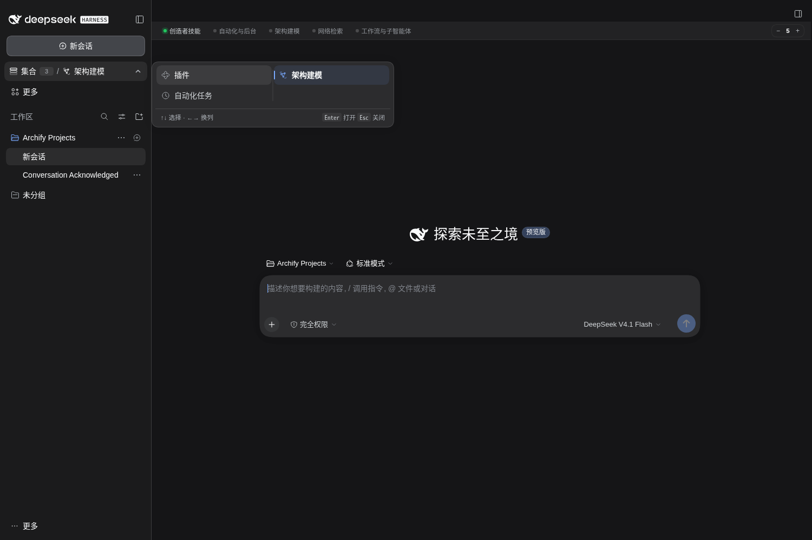
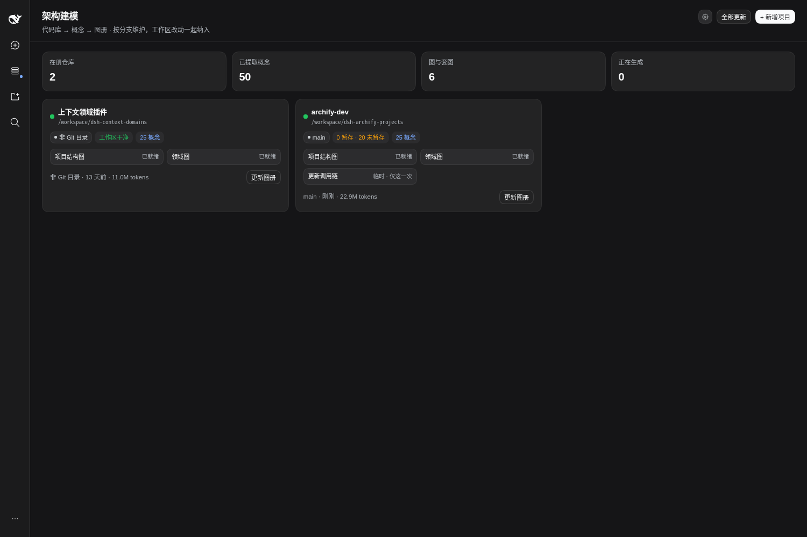
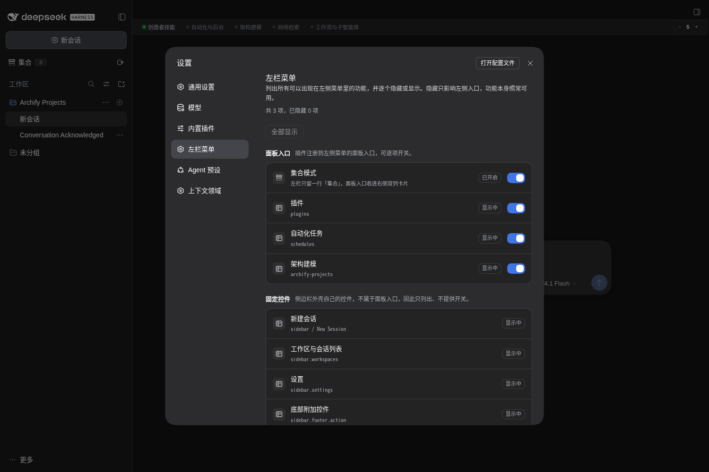

# dsh-leftpanel · 左栏菜单管理

> DeepSeek Harness 插件：把左侧菜单的面板入口收进一行「集合」，并逐个隐藏或显示。
> 入口在 **设置 → 左栏菜单**。

## 集合模式（默认开启）

左侧菜单里原本一行一个的面板入口（插件、自动化任务、架构建模……）会被收成**一行**：

```
[集合图标] 集合  (7)  /  [所选图标] Horon 记忆          [◫→]
```

- **首次点击不打开页面**：还没选过任何入口时，左栏**只有这一行**，点「集合」只会把右侧卡片打开/保持，不跳转。
- **悬浮出卡片**：从行右侧（侧栏 280 + 8）滑出一张 **448px 宽的双列卡片**，条目**逐行**填进两列（左、右、左、右……），中缝一条发丝线，已选项带 2px 强调条 + 淡底。
- **点击即选中并打开**：卡片里点某项 = 选中它并打开该页面，与直接点原来那一行完全一致；行文字立刻变成 `集合 / 图标 名称`。
- **再点直接进**：选中后点「集合」= 直接打开斜杠后那一页；悬浮仍然出卡片，可以随时换。
- **「更多」也在里面，和其它条目完全一样**：外壳溢出菜单的条目（浏览更多插件、创建你的插件……）就是**列表最后的两项**，同样逐行填进那两列，**没有分隔线、没有单独分组、没有第二层弹窗**，点击直接执行。它们不是抄来的：插件会把真实菜单开一次、读下它的行、再关掉（读取期间菜单是透明的，不会闪），所以别的插件往那个菜单里加东西也会自动跟上来。
- **键盘**：`↑↓` 沿视觉顺序走（逐行，左右左右）、`←→` 在同一行里左右挪、`Enter` 打开、`Esc` 关闭并把焦点还给行。
- **折叠侧栏**：收成 36×36 的图标轨时只留集合图标；有选中项时右下角点一个小圆点，表示「斜杠后还有东西」。
- **右端图标**：一个「面板 + 向右箭头」的标记（不是倒三角/雪佛龙），因为卡片是往右侧开，不是往下展开。

设置页里有一个 **集合模式** 开关（默认开），就在「左栏菜单」页「面板入口」表的**第一行**——页面其它部分完全不变。关掉它，面板入口和「更多」立刻恢复成原来的一行一个，卡片移除，**你自己隐藏的条目集合原样保留**。

真机效果（dsh-dev 容器，1500×1000 直出，与其它插件的 README 图同一套尺寸）：

| 刷新后未选择：左栏只有「集合」 | 悬浮展开 |
| --- | --- |
|  |  |

| 选中之后：行变 `集合 / 图标 名称` | 折叠成图标轨 |
| --- | --- |
|  |  |

设置页（原页面不变，只多一行开关）：



设计稿在 `mock/`：`collection-final.html` 是**定稿**（与实现一致，三个画板竖着排：收起 / 悬浮展开 / 空态），
`index.html` 是索引页。`mock/` 里**只有这两个 html**，整个仓库也只有这两个——早期候选（A 单列面包屑、
B 搜索分组、C 宫格、B2 徽标+双列的前身）的**可交互 html 已删掉**，只把截图留在
`docs/proto/candidates/`（要从 git 历史取回见那里的 README）。原因：OpenDesign 的「设计文件」页按扩展名
列页面、不看 `.gitignore`，四个候选摆着就是四个和定稿长得一样的完整页面，改原型时极容易点错。
实测令牌与几何只有一处权威：`mock/collection-final.html` 的 `:root`（暗/亮两套）与页末的
`<section class="spec">`；2026-11-25 删掉了过期的出题稿 `docs/proto/collection-brief.md`。

定稿的图由脚本**按画板裁切**出图，改完原型跑一次就行（以前拿固定视口拍，三个画板叠在一页里，
于是「展开」那张图实际是「收起」画板）：

```bash
node scripts/mock-shots.mjs   # → mock/shots/final-{closed,open,empty}-{dark,light}.png
```

上面那几张 README 图与原型图是两回事，别按数字对不上就以为哪边错了：`docs/screenshots/*.png` 取自
dsh-docker 容器（那台只装了 3 个面板插件，所以徽标 3、卡片 5 项），原型按本机 7 个面板画（徽标 7、
卡片 9 项）。**徽标永远只数面板行、不含「更多」的两项**，两种数字都符合这一条。

## 安装

```bash
# 从 npm 装（推荐：升级就是换个版本号，pnpm 自己管 integrity）
dsh plugin --profile web add @xirizhi/dsh-leftpanel

# 或直接拿 GitHub Release 上的构建物（不经过 npm）
dsh plugin --profile web add https://github.com/guicaiyue/dsh-leftpanel/releases/latest/download/dsh-leftpanel.tgz
```

**装完要不要重启**：只有 `client/client.js` 变的版本（0.1.2–0.1.4 都是）装完**刷新页面**就是新版，
不用动 dsh；`index.js`（Host：`/api/left-panel/state` 路由与状态文件）变了则必须
`systemctl --user restart dsh`，那段代码在进程启动时加载。

**npm 装不到刚发布的版本**：`dsh plugin add` 背后是 pnpm，默认 registry 是 npmmirror，它比 npmjs
慢半拍。要么等镜像同步，要么在 profile 目录里直接
`pnpm add @xirizhi/dsh-leftpanel@<版本> --registry=https://registry.npmjs.org`
（`dsh.profile.bundles` 里已有这个包，绕过 `dsh plugin` 也一样加载）。发布后头几分钟 tarball 还可能
404——元数据先到、边缘缓存后到，重试即可。

已在 [awesome-dsh-plugin](https://github.com/awesome-dsh-plugin/awesome-dsh-plugin) 收录（2026-11-24 合并，PR #18149），
装了 `dshmarket` 的机器也可以直接在插件市场里装。Release 的 `dsh-leftpanel.tgz` 与 npm 上同名版本内容相同
（sha512 一致），选哪条只影响升级方式：Release URL 钉在地址里的版本，npm 依赖按版本号走。

机器确实连不了 GitHub 时，可以中转：先在能连的机器上下载，再传给目标机按本地文件装
（注意 `file:` 指向的 tarball 被替换后 pnpm 不会自己更新，升级时要先传新文件再 `add`）：

```bash
curl -sL -o dsh-leftpanel.tgz \
  https://github.com/guicaiyue/dsh-leftpanel/releases/latest/download/dsh-leftpanel.tgz
sha256sum dsh-leftpanel.tgz        # 与 Release 里的 SHA256SUMS.txt 比对
scp dsh-leftpanel.tgz HOST:/path/to/plugins-dist/dsh-leftpanel-<version>.tgz
ssh HOST 'cd /path/to/dsh && dsh plugin --profile web add file:/path/to/plugins-dist/dsh-leftpanel-<version>.tgz'
```

装完 `dsh plugin add` 会把这个包写进 profile 的 `dsh.profile.bundles`，**必须重启 dsh 才生效**
（Host 半边在启动时注册 `/api/left-panel/state`，不重启就没有这个路由）。验证：

```bash
curl -s -b <cookie> http://127.0.0.1:<port>/api/left-panel/state
# {"version":1,"hidden":[],"collection":{"enabled":true,"selectedId":null}}
```

包声明了 `dsh.bundle.patch`，`dsh plugin add` 会自动把它写进 profile 的 `dsh.profile.bundles`。
手工装的话，把包名加进 profile 的 `package.json`：

```json
{
  "dsh": {
    "profile": {
      "bundles": ["@xirizhi/dsh-leftpanel"]
    }
  }
}
```

重启 DSH 后，打开 **设置**，左栏标签列里会出现「左栏菜单」。

## 它怎么工作

两个半边：

| 半边 | 文件 | 职责 |
| --- | --- | --- |
| Host | `index.js` | 把「哪些入口被隐藏」+「集合模式是否开启、选中哪一项」持久化到 Harness home 下的 `left-panel.json`，并提供 `GET/POST /api/left-panel/state` |
| Browser | `client/client.js` | 向设置页的 `settings.section` 列表注册「左栏菜单」分区，把隐藏状态应用到侧边栏行上，并注入「集合」行与它的浮层卡片 |

**为什么需要 Host 半边。** 隐藏集合必须在首屏绘制前就能读到，而且要跨重启保留。
放在 Host 侧意味着每个 profile 只有一份权威状态，浏览器侧读到的就是它。

**左栏行是怎么被隐藏的。** 侧边栏外壳拥有自己的行列表：它为 `sidebar.panellist`
的每个存活条目渲染一行，本身没有「隐藏」概念，而注销别的插件的注册也不是本插件
该做的事。本插件做的是一次表现层的处理：找到外壳那个行列表（`<nav>` 下直接挂着
面板行），按与外壳完全相同的排序规则把行与条目投影对齐，再用行的可访问名称
交叉校验，给命中的行打上 `data-dsh-leftpanel-hidden`，由本插件样式表里的一条规则
把它变成 `display:none`。

**「一行」的形状随 DSH 版本变，两代都认。** 可访问名称只在行按钮上，而行的盒子可能是
外层包裹元素：

| DSH | 行列表的直接子节点 | 标记打在 |
| --- | --- | --- |
| 0.1.x | `<button aria-label=…>` | 按钮本身 |
| 0.2.x | `<div class="…panelEntry"><button class="…panelRow" aria-label=…>…</button><button class="…panelUnpin" …></button></div>` | 外层 `div`（只藏内层按钮会留下空盒子和「取消固定」按钮） |

所以行投影按「直接子节点 → 其第一个元素子节点」取行按钮，标记落在最外层盒子上。
外壳自己的溢出启动器（「更多」）形状相同，用 `aria-haspopup="menu"` 与面板行区分，
既不算进投影、也不按面板行隐藏。只认 `<button>` 直接子节点的写法在 0.2.x 下会
一行都匹配不到，整条功能静默退化成「什么都不隐藏」——这正是 0.1.2 修掉的问题。

这样做的好处是：别的插件组件保持挂载、状态不丢；而且能自愈——`MutationObserver`
会在外壳重新渲染（切换语言、折叠/展开、插件迟到加载）时重新应用标记。当行数与
投影不一致或名称对不上时，只处理名称精确匹配的行，退化成「不隐藏任何行」，而
不会隐藏错行。

**集合行是怎么注入的。** 插件往同一个 `<nav>` 里插一个自己的按钮（`data-dsh-leftpanel-collection`），
并把它从面板投影里排除，所以它不会被自己当成一个面板项。卡片挂在 `<body>` 上、`position:fixed`，
跟着行的位置走。挂载失败时退化为「什么都不隐藏」，不会出现「菜单藏了但没有入口回来」。

**集合行固定在滚动区顶部。** 侧栏的可滚区（`nav` 与下面的工作区/会话列表同处一个滚动容器）滚到
下面时，集合行不能跟着滚走。所有面板行都被折进卡片后，那个 `<nav>` 的高度就等于集合行本身，
所以固定打在 `nav` 上（`data-dsh-leftpanel-pinned` → `position:sticky`）：行列表吸在顶部，得到
不透明背景与一条补上外壳 8px 下边距的同色 shadow，会话列表从它下面滚过去。这个属性只在集合
模式里挂，关掉集合模式立刻摘掉、外壳恢复原状（`test/dom-pass.mjs` 钉着开/关两侧）。

**持久化。** `localStorage` 只作首屏镜像，让第一次绘制就隐藏正确的行；Host 侧的
`left-panel.json` 才是权威。每次开关都会乐观写入并回报失败。

## 存储

`<DSH home>/left-panel.json`（默认 `~/.dsh/left-panel.json`）：

```json
{
  "version": 1,
  "hidden": ["plugins", "token-dashboard"],
  "collection": { "enabled": true, "selectedId": "horon" }
}
```

- `hidden` 是用户自己隐藏的条目；集合模式开启时，面板行会全部折叠，但这个集合**不会被改写**，关掉集合模式后原样生效。
- `collection.enabled` 缺省视为 `true`（旧文件没有这个键 = 全新安装 = 开启）。
- `collection.selectedId` 是斜杠后显示的那一项；指向已消失的条目时退化为「未选」。

POST 是**局部更新**：只发 `{hidden}` 不会动 `collection`，反之亦然。

损坏的文件不会让页面报错：它降级为「什么都没隐藏」，并在日志里告警一次。

## 开发

```bash
npm run verify     # 语法检查（scripts/syntax-check.mjs）+ node --test
```

三组自检，共 49 项：

- `test/client-selfcheck.mjs`（19 项）—— 模块加载器契约、只注册设置分区（且**不**
  注册左侧行）、`t` 由 `locale` 座位提供而非 `inject` 注入、双语文案键一致、样式表
  不含远程资源、`.lp-card` 只属于设置页而浮层用 `.lp-fly*`（类名冲突会让设置页的
  卡片变成浮层）、Host 侧路由注册与 `left-panel.json` 的真实读写（含损坏文件、
  并发写入、只发一半字段时的局部更新）。
- `test/dom-pass.mjs`（25 项）—— 用真实 DOM 结构验证隐藏处理与集合模式，**两代行结构
  各跑一遍**（0.1.x 的行按钮直挂 `<nav>`、0.2.x 的 `div.panelEntry` 包裹层）：命中的行
  被标记、未命中的不被标记、按 `order` 对齐、行数不一致时退化为名称匹配、名称不
  一致时宁可不隐藏；0.2.x 下标记落在包裹层而不是内层按钮、「取消固定」按钮不算一行；
  集合行被注入到行列表首位且**不被当成面板行**、开启时全部折叠、关闭时恢复且用户隐藏
  集合仍然生效、缺省配置视为开启、集合模式下整块行列表被钉住而关闭即摘掉、卡片挂在
  `<body>` 上且初始关闭、外壳的「更多」启动器随模式折叠/恢复、条目**逐行**铺进两列、
  折叠轨只留图标并在有选中项时点一个角标、集合模式下观察器仍挂在 `body` 上、
  重绘同时挂 `requestAnimationFrame` 与定时器（后台标签页里 rAF 不回调）。
- `test/mock-integrity.mjs`（5 项）—— 钉住「原型只有一份」：全仓库只许
  `mock/collection-final.html` 与 `mock/index.html` 两个 html（多一个候选就是多一个能点错
  的完整页面）、索引页里的图与画板锚点都存在、三个画板条目数与徽标一致、键盘提示
  逐字取自 `client.js`、卡片宽度等于 `CARD_WIDTH`。

在容器里跑真机（`~/Projects/dsh-docker`）：

```bash
docker compose restart dsh      # 改 client/index 后都要重启
./dev-url.sh                    # 拿地址（cookie 失效时自动抓 token）
```

## 发版

一次发布 = 一次标签推送，标签必须是 `v<package.json 的 version>`，否则 `release.yml` 直接失败。

```bash
npm version patch --no-git-tag-version
git commit -am "chore: release vX.Y.Z"
git tag vX.Y.Z && git push origin main --tags
```

workflow 会：跑 `npm run verify` → 校验标签与版本一致 → `npm pack` → 建 GitHub Release 并挂
`xirizhi-dsh-leftpanel-<version>.tgz` + 稳定别名 `dsh-leftpanel.tgz` + `SHA256SUMS.txt` → 若仓库配了
`NPM_TOKEN` secret 就发 npm（幂等，已存在则跳过）→ 自检稳定下载地址是 200。

**改了能力描述或截图**，发版后还要更新插件市场条目：

```bash
scripts/market-submit.sh
```

它幂等：给仓库加 `dsh-plugin` topic、fork `awesome-dsh-plugin`、把 `docs/market/guicaiyue__dsh-leftpanel.yml`
提成 PR。条目里没有版本号字段，`tarball` 指向稳定别名，所以只有描述/截图变了才需要重跑。

## 许可

MIT
